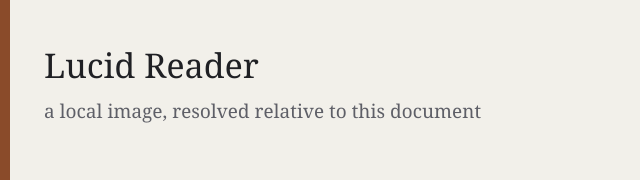

# Lucid Reader Kitchen Sink

This document is a fixture. It contains at least one occurrence of every block
and inline construct that `src/markdown.ts` implements, so opening it in the
reader exercises the whole rendering path in a single scroll. Anything that
renders wrong here is a parser or stylesheet bug, not a missing feature.

Front matter sits above this line and renders as the definition list at the top
of the page when `lucid.layout.showFrontMatter` is on. Only `key: value` lines
are read; nested YAML is ignored by design.

## 1. Headings

Six ATX levels, each one an entry in the table of contents (toggle it with the
sidebar button or the keyboard shortcut listed in the help panel).

### Level three

#### Level four

##### Level five

###### Level six

Closed ATX form, where trailing hashes are decoration rather than content: ###

Setext level one
================

Setext level two
----------------

Every heading gets a slug and a hover anchor, so [jump back to section 1](#1-headings)
works as an in-document link.

## 2. Paragraphs and line breaks

A paragraph is any run of non-blank lines. This second line is a lazy
continuation of the first, so both lines land in the same `<p>`.

Two trailing spaces force a hard break,  
so this sentence starts on its own line inside the same paragraph.

A trailing backslash does the same thing,\
which is the form that survives editors that strip trailing whitespace.

Thematic breaks come in three spellings, each rendering as one `<hr>`:

***

___

- - -

## 3. Emphasis and inline marks

*Single asterisks are emphasis* and _single underscores are too_, while
**double asterisks are strong** and __double underscores are strong as well__.
***Triple asterisks are both at once.*** Strikethrough is `~~like this~~` and
renders as ~~retracted text~~. Double equals is a highlight, so ==this phrase is
marked==.

Underscores are restricted to word boundaries on purpose, which is why
snake_case_identifiers and file_names_like_this survive without turning into
emphasis.

## 4. Inline code

Short spans look like `const x = 1`. A span containing a backtick needs a
double-backtick fence: `` a ` inside code ``. One leading and one trailing space
are stripped, so ` padded ` and `padded` render identically.

Long spans are the regression case for wrapping: `pnpm --filter @acme/reader exec vite build --mode production --outDir dist/reader --emptyOutDir --sourcemap hidden` should wrap onto as many lines as the measure needs, with the background repainted on every fragment, instead of running off the right edge.

A single unbroken token has to break mid-word rather than overflow:
`/Users/example/Library/Application Support/Code/User/globalStorage/lucid.reader/cache/9f2c1ab77d4e0b3358aa6f01c4e9d5721b8e0f4a.json`

## 5. Links

Five link forms, all of them handled by the extension's click router rather
than by the webview:

1. Inline link with a title: [the README](../README.md "Project README").
2. Autolink: <https://code.visualstudio.com/api> and <mailto:hello@example.com>.
3. Full reference link: [the marketplace listing][marketplace].
4. Shortcut reference link: [changelog].
5. Wiki link, both plain and labelled: [[kitchen-sink]] and [[kitchen-sink|a labelled wiki link]].

A wiki link without an extension gets `.md` appended, so `[[Target]]` resolves
to `Target.md` next to this file. Unresolvable references such as [not a link]
stay literal text, which is the correct fallback.

Dangerous schemes are neutralised at parse time: [this javascript: link](javascript:alert(1))
renders with `href="#"`.

## 6. Images

Relative source, resolved against this document's folder:



Inline `data:` source, which needs no file on disk:


Both images are capped by `lucid.layout.maxImageHeight` and both toggle to full
size on click.

## 7. Lists

### Unordered, tight

All three bullet markers start the same kind of list:

- hyphen marker
* asterisk marker
+ plus marker

### Unordered, loose

A blank line between items promotes each item to its own paragraph:

- First item, wrapped in a paragraph because the list is loose.

- Second item, same treatment.

### Multi-paragraph item

- The first paragraph of the item.

  The second paragraph of the same item, indented to the content column so it
  stays inside the `<li>` rather than ending the list.

### Ordered

1. Ordered with a period.
2. Second entry.
3. Third entry.

Ordered lists can start anywhere and can use a closing parenthesis:

7) Starts at seven.
8) Continues from there.

### Nested

- Top level bullet.
  - Nested bullet, indented by two.
    1. Ordered list nested inside a bullet.
    2. Second ordered entry.
  - Back to the nested bullet level.
- Second top level bullet.

### Tasks

- [x] Completed task, rendered with a filled checkbox.
- [ ] Open task, rendered with an empty checkbox.
- [X] Capital X counts as complete too.

## 8. Tables

Alignment is taken from the delimiter row: no colon means default, a leading
colon is left, a trailing colon is right, and both is centre.

| Construct      | Default        | Left aligned | Centred  | Right aligned |
| -------------- | -------------- | :----------- | :------: | ------------: |
| Heading        | `# text`       | ATX          | 1 to 6   |           yes |
| Code span      | `` `text` ``   | inline       | any      |           yes |
| Escaped pipe   | `a \| b`       | a \| b       | ok       |            no |
| Long cell      | wraps inside the cell rather than widening the table | left | centre | right |

Rows shorter than the header are padded with empty cells:

| A | B | C |
| - | - | - |
| 1 | 2 | 3 |
| 1 |

## 9. Code blocks

Fenced with a language label, which becomes both the caption and the
`language-*` class:

```ts
export const add = (a: number, b: number): number => a + b;

// A deliberately long line, so the Wrap button in the caption has something to
// act on: const configuration = { theme: 'paper', measure: 72, lineHeight: 1.6, hyphens: 'auto' };
```

Fenced with no language, which falls back to the `text` label:

```
plain text fence
```

Fenced with tildes, which lets the body contain backtick fences:

~~~md
```js
console.log('a fence inside a fence');
```
~~~

Indented four spaces, the older form, also rendered as a `text` figure:

    indented code block
    second line

Every code figure carries a caption with Copy and Wrap buttons. Wrap is global:
it writes `lucid.layout.wrapCode`, so pressing it on one block rewraps all of
them.

## 10. Blockquotes

> A blockquote holds full blocks, not just text.
>
> - Including lists.
> - And more than one paragraph.
>
> > Nested quotes indent by one level per marker.

> A quote can also use lazy continuation,
where the second line carries no marker at all.

## 11. Callouts

Ten keywords are recognised, in the GitHub alert syntax. Four pairs share an
accent colour (`NOTE` with `INFO`, `TIP` with `EXAMPLE`, `IMPORTANT` with
`QUESTION`, `CAUTION` with `DANGER`), while `WARNING` and `QUOTE` have their
own, so all ten appear below rather than one per colour.

> [!NOTE]
> Neutral aside. The title defaults to the keyword when none is given.

> [!INFO] Custom title
> A callout title can be overridden by text on the marker line.

> [!TIP]
> Something worth doing.

> [!EXAMPLE]
> A worked case.

> [!IMPORTANT]
> Something the reader must not skip.

> [!QUESTION]
> An open question.

> [!WARNING]
> Something that can go wrong.

> [!CAUTION]
> Something that will go wrong.

> [!DANGER]
> Something destructive.

> [!QUOTE]
> An attributed passage.

Callouts hold nested blocks the same way blockquotes do:

> [!IMPORTANT] Callouts nest other blocks
> 1. A list inside a callout.
> 2. With a second item.
>
> ```sh
> echo "and a code block"
> ```

## 12. Footnotes

Footnote references render as superscript numbers[^first] and collect into a
Notes section at the end of the document[^second]. A reference whose definition
is missing[^missing] stays literal, which makes typos visible instead of silent.

## 13. Raw HTML allowlist

Raw HTML is escaped first, then a fixed list of inert tags is restored, with all
attributes stripped. That list is `br`, `kbd`, `sub`, `sup`, `mark`, `ins`,
`del`, `abbr`, `small`, `u`, `s`, `details`, `summary`, `dl`, `dt`, `dd`, `wbr`.

Keys look like <kbd>Ctrl</kbd> + <kbd>Shift</kbd> + <kbd>P</kbd>. Chemistry gets
H<sub>2</sub>O and mathematics gets E = mc<sup>2</sup>. There is <mark>marked
text</mark>, <ins>inserted text</ins>, <del>deleted text</del>, <u>underlined
text</u>, <s>struck text</s>, and <small>smaller text</small>. An
<abbr>HTTP</abbr> abbreviation keeps its text but loses its `title`, because
attributes are never restored.

Anything outside the list survives as visible text, which is the safety
guarantee working as intended: <div align="center">this div is literal</div>,
and so is <script>alert(1)</script>.

A literal `<br>` tag breaks a line<br>exactly like two trailing spaces do, and
`<wbr>` marks an optional break point inside a long word such as
super<wbr>cali<wbr>fragilistic<wbr>expialidocious.

<details><summary>A disclosure widget</summary>
Its contents. Note that the `open` attribute would be stripped, so it always
starts closed.
</details>

A raw description list, the same element the front matter block uses:

<dl>
<dt>Term</dt>
<dd>Its definition.</dd>
<dt>Second term</dt>
<dd>Its definition.</dd>
</dl>

## 14. Typography

Smart quotes are on by default, so "double quotes", 'single quotes', and an
ellipsis... are converted at parse time. Code spans are stashed before this pass
runs, which is why `"quotes inside code"` stay straight.

Smart dashes are off by default. With `lucid.typography.smartDashes` on, two
hyphens between spaces become an en dash and three hyphens become an em dash:

| Input    | Rendered with your current setting | Result when the setting is on |
| -------- | ---------------------------------- | ----------------------------- |
| `a -- b` | a -- b                             | a – b (en dash)                |
| `a---b`  | a---b                              | a—b (em dash)                  |

The middle column is raw text, so it changes as soon as you turn the setting on.
The right column is the literal character, so it never changes and gives you
something to compare against.

## 15. Escapes and edge cases

Backslash escapes keep punctuation literal: \*not emphasis\*, \_not emphasis\_,
\`not code\`, \# not a heading, \[not a link\], and a literal backslash \\.

A line that looks like a list but is escaped stays a paragraph:

\- not a list item

Unicode passes through untouched: αβγ, 日本語, emoji 🌤, and combining marks é.

An empty heading, a heading with only punctuation, and a duplicate heading title
all still produce a usable slug. The three headings below prove each case: the
first two fall back to the slug `section`, and the last two share a title, so
the second one gets a `-1` suffix.

###

### !!!

### Duplicate title

First occurrence.

### Duplicate title

Second occurrence.

---

Reading features that are not markdown constructs (focus mode, bionic reading,
the ruler, find, the progress bar, themes) apply to everything above and are
listed in the reader's own help panel.

[marketplace]: https://marketplace.visualstudio.com/ "Visual Studio Marketplace"
[changelog]: ../CHANGELOG.md "Release notes"

[^first]: The first note. Footnote bodies accept inline markup, including
    `code`, *emphasis*, and [links](https://example.com).
[^second]: The second note, numbered in definition order rather than reference
    order.
